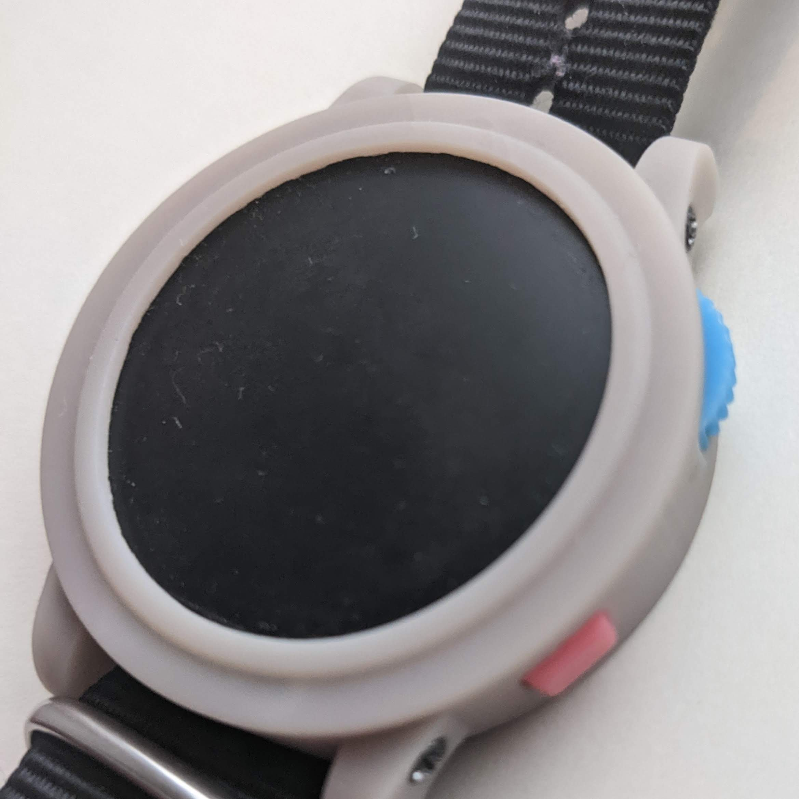

# Disqo

A wearable synthesizer — a smartwatch with three buttons, a high-resolution magnetic scroll wheel and a circular LCD display, designed for building a synth you can run on your wrist.



## Hardware

Disqo is built around a custom PCB designed in KiCad.

| Component | Description |
|---|---|
| **ESP32-PICO-MINI-02** | Espressif SiP with 8 MB flash and 2 MB PSRAM |
| **GC9A01 round LCD** | 240×240 pixel 1.28" circular TFT display over SPI at 80 MHz |
| **AS5600** | 12-bit magnetic rotary encoder over I2C — acts as a high-resolution scroll wheel (like a watch crown) |
| **3 buttons** | Physical inputs for navigation, selection and sleep/wake |
| **Piezo buzzer** | PWM-driven audio output (beep/boop, future synth capabilities) |
| **MCP73831-2** | Single-cell Li-Po battery charger via USB |
| **32.768 kHz crystal** | External RTC clock source for accurate timekeeping |
| **Battery ADC** | Monitors battery voltage |

The PCB files, schematic, BOM and 3D models live in the `pcb/` directory. An interactive HTML BOM is available at `pcb/bom/ibom.html`.

## Firmware

The firmware runs on **MicroPython** with a patched [gc9a01_mpy](https://github.com/russhughes/gc9a01_mpy) C module compiled in for fast display drawing.

### Structure

```
firmware/
├── main.py              # Entry point — launches the watchface
├── boot.py              # MicroPython boot stub
├── apps/                # Applications (clock, main menu)
├── gui/                 # UI framework (menus, themes, text layout)
├── system/              # Hardware abstraction layer (HAL)
├── utils/               # Encoder math, datetime formatting, font helpers
├── fonts/               # Bitmap and TTF font definitions
├── scripts/             # Build, deploy and helper scripts
├── patches/             # Patches for gc9a01_mpy and MicroPython ESP32 port
└── typings/             # MicroPython type stubs for IDE support
```

### Watchface

The current primary watchface features:

- DSEG7-style digital clock with "ghost" segments
- Greeting text that changes by time of day (Good morning / afternoon / evening)
- Battery icon with voltage display
- Date with day-of-week
- Double-buffered rendering with a textured background

### Controls

- **Rotary encoder (scroll wheel):** Scrolls through menus and adjusts values
- **Button 1 (B1):** Wake from deep sleep; back/cancel in menus
- **Button 3 (B3):** Open main menu; select in menus
- **B1 + B3 combo:** Enter deep sleep

### Apps

- **Clock** — Date, time, battery status, encoder angle
- **Main Menu** — Scrollable menu with items: date/time, alarm, theme, brightness, metronome, drone (sub-apps are still planned)

## Building & Deploying

### Prerequisites

- MicroPython source
- ESP-IDF toolchain
- `esptool` and `mpremote`

### Compile MicroPython

The build script compiles MicroPython for the `GENERIC_SPIRAM` board with the patched `gc9a01_mpy` module:

```bash
cd firmware/scripts
./compile-micropython.sh
```

Patches are applied before building:

- **gc9a01_mpy.patch** — Faster display init, adds `draw_len` for text measurement
- **micropython-ports-esp32.patch** — Configures 80 MHz flash/SPIRAM, external RTC crystal, faster deep sleep wake

### Deploy code to device

```bash
cd firmware/scripts
./copy-code.sh
```

This uses `mpremote` to copy the Python source files to the device and syncs the RTC to the host clock.

### Set time

```bash
cd firmware/scripts
./set-time.sh
```

## Future Plans

- **Audio synthesis:** Wrap `pwm_audio` for better piezo output, classic Bluetooth audio, digital audio synthesis libraries
- **Sub-apps:** Date/time setting, alarm, theme selector, brightness control, metronome, drone
- Smarter input polling and debouncing
- Theme persistence in non-volatile memory
